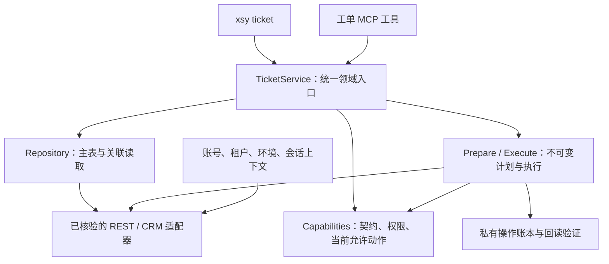

# 基于 xiaoshouyi-cli 的技服工单生命周期实现设计

设计日期：2026-11-24，北京时间。适用代码基线：xiaoshouyi-cli 0.4.1。

本文保留实现设计和证据边界。2026-11-24 已按复用评估新增可运行工单模块、CLI/MCP、执行账本、请求适配及测试；实际交付状态见第14节，使用与配置以 `skill/references/tickets/README.md` 为准。初始业务事实来自用户核验报告；后续已按用户授权复用NeoCRM登录态完成真实只读联调，没有创建、修改、分派或关闭记录。下文设计接口如与运行命令不同，以代码与使用说明为准。

2026-11-24 再次按原目标复核后的修补前差距见 [fieldjob-gap-audit-2026-11-24.md](fieldjob-gap-audit-2026-11-24.md)。随后已补齐认证provider、编号/时间配置、引用与约束、无回执恢复及本地集成验证，最新状态见 [开发交接与测试指南](fieldjob-development-handoff.md)。按用户最新要求，P3/P4真实CRM测试留给用户后续执行，不作为本轮已完成的业务验收。

核验报告对应页面：[销售易 fieldJob 列表](https://crm.xiaoshouyi.com/bff/neoweb#/entityGrid/fieldJob?objectApiKey=fieldJob)。

复用评估更新：首版沿用现有单环境、单账号的 CLI/MCP 部署方式。P0 收敛为现有能力复用与必要修补；多账号 profile、认证整体重构、替换 MCP SDK、独立工单 MCP 进程及新的数据库选型均按实际需求决定，不作为只读接入的前置条件。逐项复用判断见第 13 节。

## 1. 实现结论与证据边界

在现有 TypeScript、Commander、Axios、Vitest 框架上新增 `fieldJob` 工单领域模块。CLI 与 MCP 共享领域服务和动作执行器，界面层只负责参数、认证上下文传递和结果展示。

用户报告的读验证足以支持启动只读接入开发；生命周期写入需要逐项补齐业务动作契约。字段描述、状态枚举和通用 PATCH 接口不能代替动作契约。

| 已有证据 | 实现中的使用方式 | 不可据此推断 |
|---|---|---|
| 页面主对象为 `fieldJob` | 工单查询和元数据以该对象为准 | `serviceCase` 是同一对象或可作为兼容别名 |
| 当前账号可见 43,160 条，已核验 3 条样本 | 记录为 2026-11-24 的账号可见范围快照 | 固定总量、全租户总量、其他账号同样可见 |
| 对象有 162 个字段 | 接入完整 describe 后建立字段映射 | 当前仓库已保存这 162 个字段；目前仓库只含 9 个销售对象的完整元数据 |
| queryable/createable/updateable=true，disabled=true | 分别保存原始标记与来源，保留歧义 | 当前用户有写权限，或 disabled=true 足以否定已实测的读能力 |
| 业务类型列表与样本类型不匹配 | 将类型、默认值和历史类型核验列为创建前置依赖 | 从“远程工单”或“Zendesk”的列表随选一个类型 ID |
| 派工池、报告、工时对象已识别 | 建立待核验关联清单 | 关联字段、写入顺序、接口地址或 payload 已确定 |

报告没有包含原始 describe、创建表单或动作请求响应。不能从摘要生成冒充真实接口证据的 fixture。

## 2. 现有代码复用与局部扩展

以下路径相对仓库根目录 `/work/project/xiaoshouyi-cli`。

| 当前文件 | 可复用部分 | 工单接入的最小补充 |
|---|---|---|
| `src/auth/manager.ts`、`src/auth/storage.ts` | 直接沿用 OAuth、Token 刷新、环境变量 Token 与现有凭据存储 | 修复 `API_BASE_URL` 未导入；计划绑定当前身份范围，核实 env Token 与存储账号归属。多账号隔离在出现该需求时扩展 |
| `src/api/client.ts` | 沿用 Axios、租户 API 域名、Bearer 注入与已核验读取的认证重试 | P2 为新工单写入提供禁止自动重放的请求选项；不以全局 HTTP 重写作为 P1 前置 |
| `src/api/crm-client.ts` | 复用 `getCrmCookie`、会话获取及符合契约的表单请求 | `crmPost` 已支持 `autoRefresh: false`，编码吻合的写动作可利用该开关；JSON/上传协议按真实契约适配 |
| `src/services/object.service.ts` | 优先复用 `describeObject`、`queryObjects`、经核验的 `getObject`；复用创建请求的 `{data}` 包装经验 | 在工单适配边界解码真实返回体；P2 加入仅针对已登记工单对象的通用写入保护 |
| `src/types/index.ts` | 沿用已有响应、查询与认证类型的适用部分 | describe 实际为 `data` 和 `apiKey/createable/updateable`；局部增加原始类型及归一化映射，避免无差别更改既有销售输出 |
| `src/api/errors.ts` | 沿用 `XsyError/ApiError/NetworkError` 及适用分类 | 扩展工单错误码和 403 权限分支；保留写入是否确定执行的信息 |
| `src/middleware/auth-check.ts` | CLI 可沿用 `withAuth`，共享服务可复用 `getToken` | MCP 认证失败抛类型化错误，不调用含 `process.exit` 的 CLI 包装；无需先重写全部命令中间件 |
| `src/cli.ts`、`src/commands/shared.ts`、`src/api/format.ts` | 直接沿用 Commander、字段参数解析、JSON/表格输出 | 新增 `ticket` 命令，显式合并全局选项；输出前做字段投影。现有 `--fields` 仅影响表格，不能承担 JSON 隐私过滤 |
| `src/mcp-server.ts`、现有 Zod 依赖 | 沿用 stdio 入口及工具发现/调用方式，补充工单 handler 和参数校验 | 注册首期只读工具；局部修协议解析/错误处理问题。SDK 替换和新 bin 均可后置 |
| `tests/unit/*` | 沿用 Vitest、已有 SQL/格式/错误测试 | 在相应阶段新增真实新增行为的测试；不为已有纯函数复制一套工单同构测试 |

设计初审时尚未安装依赖，存在依赖镜像 DNS 和 `src/commands/meta.ts` 递归结果类型等问题。相关构建修补已落地；2026-11-24 最终本地检查中类型检查、285项测试、构建及CLI/MCP冒烟检查通过。

## 3. 模块与依赖方向

图中的框表示职责，可以先在一个领域服务中实现；不要求每个框都建立独立框架或文件。



按阶段最小新增的文件：

```text
src/
  services/ticket.service.ts     # P1：复用对象服务，封装查询/详情/能力
  commands/ticket.ts             # P1：沿用 Commander 与共享格式化
  tickets/
    types.ts                     # P1：字段、能力与输入类型；小规模 schema 就近放置
    contracts.ts                 # P1：核验状态；P3/P4：已核验动作登记
    actions.ts                   # P2：prepare/execute、指纹、前置检查与回读
    operation-store.ts           # P2：私有计划/操作账本、互斥与恢复
    adapters/                    # P3/P4：只为已核验接口按需新增适配器
tests/
  unit/tickets/                 # 各阶段新增行为的测试
  contract/tickets/             # 取得真实接口证据后新增契约测试
  fixtures/tickets/             # 脱敏且标注来源/版本
skill/references/tickets/       # 按需补充字段、动作和使用边界
```

现有 `src/cli.ts` 注册新命令；现有 `src/mcp-server.ts` 注册调用同一服务的只读工单工具。工具增多时可提取 handler 映射，使用 `package.json` 已声明的 Zod 校验，无需先引入 MCP SDK 或新增构建入口。

`xsy-mcp` 的默认配置保持只读；写工具在 P2/P3 通过明确配置后才注册，并继续执行计划/确认/权限检查。若后续确需隔离部署，再新增 `xsy-tickets-mcp` 并更新 `package.json`/`tsup.config.ts`。两种选择共享同一套领域模块。

不提前建立 `runtime/context.ts`、通用 `api/request.ts`、独立 repository/capabilities/metadata 框架或数据库层；在工单服务就近实现小型函数，出现第二个真实使用方或复杂度增加后再提取。

## 4. 身份、HTTP 与结果策略

### 4.1 运行上下文

首版通过现有 `getAuthManager()` 与凭据来源构造轻量身份快照，记录环境、可验证的 tenantId/subjectId、API/CRM 地址和凭据引用。快照用于计划与操作结果的归属校验，不要求先实现 profile 管理器或替换认证单例。未知身份信息明确保留为未知。

OAuth、Cookie、元数据缓存、引用解析缓存、计划和账本绑定同一身份范围。首版支持单环境、单账号进程；多账号并行时再扩展各账号的实例与存储隔离。

默认按一个 MCP 实例一个账号运行；多用户服务必须由可信宿主注入每个请求的身份上下文，不能让工具参数中的任意 `userId` 冒充当前用户。

仅有 env Token 时，不能自动拼接本地另一个账号的租户、用户或 Cookie。写入前如无可靠身份绑定证据，返回身份未核验；不从 Token 文本格式或硬编码租户推断身份。现有审批服务的默认租户值不能复制到工单适配器。

### 4.2 HTTP 策略

- 请求声明 `operationKind: read | write`。业务读取可能是 POST，不能只按 HTTP 方法分类。
- 该分类先作为工单动作的内部元数据。REST 客户端只增加局部重试控制选项；已核验且编码吻合的 CRM 表单写请求利用现有 `autoRefresh: false`。不预设全项目迁移到新的 HTTP 框架。
- 请求发送前刷新将过期的认证。对于已核验读取，按契约限制重试次数；写入默认不因 401、超时、断连、HTML 登录页、5xx 或响应解码失败而自动重放。
- 只有服务端明确保证幂等或请求未执行时，才为特定写动作登记重试能力；没有证据则保持禁用。
- 不同接口按各自契约解析 `code/result`、`code/data` 或 `status/data`，验证业务成功码；不可把 `data` 一律当 `result`，也不能全局把 code=0 当成功。
- 保留错误类别、HTTP/业务状态、可用的服务端请求标识与本地操作号。响应摘要不含 Cookie、Token 或完整客户资料。
- 403 返回权限不足；401 才进入认证错误分支。env Token 失效不应顺便删除不属于该 Token 的本地账号凭据。

### 4.3 私有数据

列表默认返回明确字段和有限条数。详情或关联资料仅在该账号授权范围内按需读取。模板、fixture、提交到仓库的文档不包含真实标题、联系人、客户资料、记录 ID 或凭据。

含最终 payload 的计划保存在仓库外的账号专属私有目录，目录权限 0700、文件权限 0600，并处理已有文件权限。审计摘要只保留身份范围引用、操作号、动作、结果、指纹、验证覆盖及必要的私有目标引用。完整 payload 不写入普通日志或审计摘要。

## 5. fieldJob 领域模型与读取

| 领域含义 | 原始字段 | 处理约束 |
|---|---|---|
| 标题 | `name` | 不作为工单编号推断来源 |
| 状态、阶段 | `status`、`customItem62__c` | 同时保留原始值和标签；状态与阶段独立保存 |
| 优先级 | `priority` | 已知活动标签 P1/P2/P3/P4，写入值仍以元数据/表单契约为准 |
| 负责人 | `responsibleTE__c` | 与所有人、分配人分别映射 |
| 所有人 | `ownerId` | 创建可写、更新不可写；不能用负责人变更推导 ownerId 更新 |
| 分配人、分配方式 | `assigner`、`dispatchMethod` | 由已核验分派动作决定填写/回读关系 |
| 派工池 | `fieldJobPoolGroup` -> `fieldJobSea` | 验证引用可见性、池规则和候选人员 |
| 业务类型 | `entityType` | 创建可写、更新不可写；历史/默认类型单独核实 |
| 部门、地址 | `dimDepart`、`address` | address 的具体结构不能假设为普通字符串 |
| 描述 | `description`、`problemDescription__c` | 保留两个字段；回复和处理历史不通过覆盖描述实现 |
| 附件 | `customItem69__c` | doc 字段不能直接用本地路径或猜测的文件 ID 填写 |
| 客户、资产 | `fieldJobAccountId`、`fieldJobAssetId` | 按已核验引用关系读取，避免不受控跨对象扩展 |
| 实际起止时间 | `actualStartTime`、`actualEndTime` | 按字段类型与接口契约解析，不以状态名推算 |

工单编号字段、创建/更新时间字段及默认列表排序尚未在报告中明确。先核验后开放对应筛选；不能把 `name`、`id`、`createdAt` 等候选自动视为已确认业务编号或日期字段。

报告列出的状态名称包含 New（待处理）、Process-1（待反馈）、Process-2（处理中）、纠纷待反馈、纠纷处理中、Resolved（已解决）、Completed（已完成）、Evaluated（已评价）、Closed（已关闭）、暂停跟进、已作废；阶段包含草稿、工单处理、工单结单、工单关闭。真实联调已确认：NeoCRM可返回标签数组，REST使用数值value，不能把New等名称直接当REST原始值；枚举不用于推导允许迁移。

查询入口接受结构化条件，不开放任意 SQL 或任意对象名。字段、操作符、排序项采用白名单；字符串转义、ID/枚举校验、日期区间和每页上限统一处理。列表按需分页，每页不超过接口已验证上限，首版建议默认 20、上限 100，并返回是否截断、下一页信息和统计口径。

不为每次查询拉取 43,160 条记录；全量导出需单独声明范围、上限和私有输出位置。稳定排序或游标用服务端已验证能力；offset 分页在数据持续变化时不宣称具备快照一致性。记录 ID 在领域接口中用字符串表示，并避免 JSON 数字解码时丢失精度。

时间线聚合远端处理记录、状态历史、回复、报告及工时，但每类来源都要先核验关联契约。局部来源不可用时返回 `coverage=partial` 及缺失来源；全部未核验时返回 `UNVERIFIED`，不能把空数组解释为没有历史。本地操作账本单独标明来源，不冒充 CRM 完整审计历史。

## 6. 能力与真实动作契约

三类判断分别存储：

| 判断 | 值 | 含义 |
|---|---|---|
| 动作契约核验 | `verified / unverified / unsupported` | 是否掌握真实动作协议；unsupported 需要明确证据，未查到不等于不支持 |
| 当前身份权限 | `allowed / denied / unknown` | 当前用户对该类型/记录是否有权限 |
| 当前记录动作 | `allowed / denied / unknown` | 当前状态、角色、派工池和配置下是否允许执行 |

三项均满足执行条件才生成可执行计划。对象标记和枚举不能替代后两项；无法取得动作或权限信息时明确返回 unknown，不生成一张本地猜测的全局状态流转图。

例如，在关闭协议尚未核验时，能力结果应能明确表达：

```json
{
  "objectApiKey": "fieldJob",
  "action": "close",
  "contract": "unverified",
  "permission": "unknown",
  "recordAction": "unknown",
  "executable": false,
  "missingEvidence": ["真实关闭动作协议", "当前用户权限", "当前记录允许动作"]
}
```

每个已核验动作契约至少包含：

- 环境/租户、业务类型、动作名称、适用范围及证据版本；
- 真实 endpoint、HTTP 方法、认证/会话/必要头、编码与 payload schema；
- 当前允许动作、权限、表单默认值及条件必填的获取方式；
- 成功/拒绝/结果不确定的判定方式；
- 是否有服务器并发条件与幂等能力及其原始证据；
- 执行后应回读的主表、历史、SLA/报告/通知/外部同步证据与可观察边界。

报告中的 create、assign、accept、reply、pause、resume、escalate、resolve、complete、close、reopen、return、void 均作为候选动作登记。它们并非现有可调用能力；逐个取得契约并验收后启用。

创建必填以对象约束、当前业务类型表单、默认值及条件规则的有效组合校验。当前已知候选为标题、派工池、业务类型、地址、状态、部门；字段类型、默认值与条件规则缺失时不能声称已完成最终 payload。

分派不能简化为更新 `responsibleTE__c`；关闭不能简化为 PATCH `status/customItem62__c`；作废不能用通用 delete 替代。所有人、负责人、池、分配人与分配方式的联动由真实动作及回读结果验证。

### 通用 CRUD 保护

新增工单模块时，同步在通用对象服务中拒绝对 `fieldJob` 的通用 create/update/delete，返回引导到工单 prepare/execute 的错误；后续纳入保护的关联对象必须由核验后的注册表明确列出。不能只在 `ticket` 命令中禁止状态更新，而留下 `xsy update fieldJob ...` 的旁路。

该保护与 P2 写入执行框架一同交付；P1 只读版本无需为了查询能力预先修改整个通用写入链路。

工单动作适配器不通过“跳过保护”的公共参数调用通用服务。其写入使用内部已登记契约，调用方不能传入任意路径、方法或 payload。这是本项目内的执行约束，不宣称能限制持有同一 CRM 凭据的其他客户端。

## 7. prepare / execute 契约

### 7.1 prepare：仅读取与本地计划生成

输入为动作、单个明确目标（创建时为类型/池等范围）和动作所需参数。依次读取身份范围、元数据、表单规则、引用对象、最新记录及当前允许动作，验证用户权限和动作契约。

同名客户、人员、派工池或部门匹配多项时返回候选歧义，不默认选第一项。原始类型值没有对应映射时保留原始值，创建流程返回缺少类型证据。

可执行计划至少包括：

```typescript
interface TicketPlan {
  planId: string;
  operationId: string;
  contextRef: string;          // 绑定环境、租户、账号
  action: string;
  targetRef: string;
  contractVersion: string;
  metadataVersion: string;
  preconditions: unknown;      // 状态、阶段、负责人、池、相关表单规则等
  request: {
    contractId: string;        // 由内部契约解析真实方法和路径
    payload: unknown;         // 已验证的最终业务 payload
  };
  expectedEffects: unknown;
  verificationCoverage: unknown;
  fingerprint: string;
  createdAt: string;
  expiresAt: string;
}
```

接口返回的是判别联合：`blocked` 或 `ready`。未核验协议、权限未知、当前不允许、缺字段等均返回 blocked 和明确原因；不提供可执行指纹。仅供表单草拟的结果明确为 provisional，不能流入 execute。

指纹覆盖规范化的身份范围、目标、动作、契约版本、前置状态、最终业务请求、附件内容哈希和到期时间。认证头、Cookie、短期会话凭据不回显；若服务端需要临时令牌，契约需明确其刷新方式，不能借刷新令牌更改已确认的业务 payload。

prepare 不执行 CRM 试创建、附件上传或其他远端写入。附件在此阶段最多读取用户指定本地文件的属性和内容哈希。

### 7.2 用户确认与 execute

确认内容包括具体环境/身份、目标、字段、范围、最终 payload 和已知影响。用户已有的明确授权可以满足对应范围的确认要求，无需机械重复确认；payload、目标或范围变化后原确认失效。

当前仓库及已检查的父目录中未发现 `AGENTS.md`。方案中的确认要求应在执行代码与使用说明中落实；后续增加仓库规则时与该边界保持一致，不能只依赖一条给 Agent 阅读的文字规则。

指纹是计划一致性校验，不是用户授权凭证。Agent 生成一份计划后把指纹原样回传，不能自动视为用户确认；MCP 工具的 `confirmed: true`、工具标注或启用写工具的配置也不能替代授权。可信宿主或执行边界负责校验与计划绑定的确认来源。

execute 只接受已保存的 planId、指纹及与其绑定的确认信息；不接受替换 payload。执行步骤：

1. 校验计划完整性、到期时间、身份范围、确认范围和当前契约版本。
2. 获取跨进程的计划执行权，避免 CLI 与 MCP 同时执行同一计划。
3. 复读最新工单及当前权限/允许动作，比较会影响动作的前置条件。变化时返回 `PLAN_STALE`，重新 prepare，不能静默重算 payload。
4. 服务端如有已核验条件更新则使用；没有则明确 `best_effort`，本地复读与锁不保证阻止网页或其他客户端在提交前修改。
5. 在发送前持久化操作号及 dispatching 状态，再按契约发送一次写请求。
6. 分类处理响应，读取必要的主表与联动对象，返回验证结果。

首版一份计划只处理一张工单或一次创建，不把批量动作隐含为循环执行。需要批量时另行定义范围、逐项计划及部分成功语义。

### 7.3 结果不确定与账本

建议账本使用支持事务的本地存储；采用文件时必须实现跨进程排他、原子写与崩溃恢复，不能用普通 JSON 读改写模拟原子消费。

主要状态为 `prepared -> dispatching -> applied_pending_verification -> verified`，另有明确拒绝的 `rejected` 和 `outcome_unknown`。写入成功但回读失败时保留“已提交、验证未完成”，不能标成“失败可重试”。进程在 dispatching 阶段崩溃，恢复后也不能自动重发。

相同 operationId/planId 再次调用返回已有状态，不重新提交。该能力只约束共享账本范围内的客户端，不等于服务器幂等，也不能保证跨设备 exactly-once。

结果不确定时按服务端返回 ID、已验证业务关联条件、历史事件等回查。operationId 在没有服务端支持时仅是本地编号，不能擅自写入一个猜测的 CRM 字段。按标题/时间找到相似记录不能自动证明是该次创建；无法唯一确认则维持 outcome_unknown。

回读验证区分主表状态、历史记录及关键副作用。通知、SLA 或外部同步如为异步，用有上限的轮询/事件证据确认；超时返回 pending/partial，不以单次 GET 成功宣称全生命周期联动完成。

## 8. CLI / MCP 接口

| 领域能力 | 拟新增 CLI | 拟新增 MCP | 首期边界 |
|---|---|---|---|
| 结构化检索 | `xsy ticket search` | `tickets_search` | 先启用已核验字段；页大小与返回字段受控 |
| 工单及关联详情 | `xsy ticket get <id>` | `tickets_get` | 未核验关联明确标出覆盖缺口 |
| 当前能力 | `xsy ticket capabilities [id]` | `tickets_capabilities` | 区分契约、账号权限与记录允许动作 |
| 时间线 | `xsy ticket timeline <id>` | `tickets_timeline` | 时间线来源契约未核验前返回 unverified |
| 动作预览 | `xsy ticket prepare <action>` | `tickets_prepare` | 缺契约时 blocked，不产生可执行计划 |
| 已确认动作执行 | `xsy ticket execute <planId>` | `tickets_execute` | 第二阶段后按动作启用 |
| 操作回查 | `xsy ticket operation get <operationId>` | `tickets_operation_get` | 便于跨进程重入、超时和崩溃后的结果查询 |
| 附件读写 | 工单附件子命令 | 附件 prepare/execute/download 工具 | 按已核验协议后续启用 |

CLI 与 MCP 使用同一 schema、能力判定、分页口径、计划及账本。`--dry-run` 对工单写入只能产生预览，不调用 execute；全局 `--yes` 不绕过计划一致性、权限核验或确认范围。

MCP 只读/写入注解用于表达工具性质，不能代替实际执行门禁。业务错误携带稳定错误码与可处理详情；stdout 仅用于协议结果，诊断写 stderr 且脱敏。未知动作返回 `UNVERIFIED` 或有证据的 `UNSUPPORTED`，不回退到任意字段更新。

## 9. 处理记录、附件、工时与报告

每类资源单独核验主对象、关联字段、可见性、创建/读取协议及必要联动。不能把 account/opportunity 跟进接口的数字 objectId 直接套到 fieldJob。

回复明确区分内部/外部可见性；协议未证实时不提供一个凭猜测生效的 private/public 参数。处理记录采用真实追加对象或动作，保留历史；禁止用覆盖 description 模拟追加。

附件上传可能包含“上传二进制 -> 取得文件句柄 -> 关联工单”多个阶段。每个写阶段都纳入同一确认范围和账本，绑定本地文件内容哈希；文件变化则计划失效。上传成功而关联失败需报告部分完成与私有句柄，不自动重新上传。清理孤立文件仅在删除协议和授权范围明确时执行。

下载按已核验资源标识和当前身份进行，服务端返回链接的目标受契约约束，输出到用户指定的私有位置；文件名不直接作为任意本地路径使用。

工时与报告按其独立 schema 校验时长、起止时间、参与人、版本及关联关系。当前无法确认的解决/结单前置资源保持 blocked。

## 10. 分阶段交付与验收

| 阶段 | 实现任务 | 验收标准 | 依赖 |
|---|---|---|---|
| P0 复用现有能力与必要修补 | 沿用构建、认证、HTTP、错误与输出；恢复依赖安装，修实际类型错误；局部适配工单返回体 | 类型检查、现有测试、构建通过；已有销售接口和输出可用 | 本地开发环境及依赖源；无需预先完成多账号/profile/SDK 改造 |
| P1 只读工单接入 | 用现有 describe/query/get 封装 search/get，新增能力判断；在既有 CLI/MCP 注册 | 当前账号分页/权限正确；原始状态与标签不混淆；未核验能力不冒充可执行；缺关联不冒充空历史 | 只读接口和脱敏契约 fixture；GET 详情、编号/日期字段按实际证据确认 |
| P2 新增共用执行机制 | 新增动作契约、动态校验、prepare/execute、私有操作账本；复用认证/HTTP/读取回查；局部禁止工单写重放并保护通用写入口 | 用模拟适配器验证计划变更、确认范围、权限、并发、重复调用、超时和进程恢复；未核验真实动作继续不可执行 | P0/P1；这是工单执行能力的新增，不是基础平台重建 |
| P3 接入核心动作与测试闭环 | 共用 P2 执行器，仅逐项登记 create/assign/reply/resolve/close、必需中间动作及报告/工时契约 | 在明确授权的测试目标完成闭环并回读关键副作用；不假定解决后可直接关闭；生产写入在闭环通过后启用 | 每个动作的真实接口、类型/角色权限、测试目标及最终 payload |
| P4 复用执行机制扩展动作 | pause/resume/escalate/reopen 等分支复用 P2；附件、工时、报告按核验契约增加必要适配 | 每条分支与各业务类型分别验收；附件额外验证上传/关联的部分完成；不可用能力保留原因 | 分支动作、关联资源及外部同步证据；P3 若已需要某资源，则提前实现其最小范围 |

P1 可以先交付检索、详情和能力查询。只有 P1 或只有模拟契约时，不能把交付物命名为“全生命周期已接入”。时间线只有在来源契约验证后才计入完成范围。

建议开发检查顺序为：依赖安装成功后，`npx tsc --noEmit`、`npm test`、`npm run build`；随后对新 CLI 和 MCP 做无写入的协议/入口验证。测试闭环作为单独的显式集成步骤，不混入默认单元测试命令。

## 11. 契约测试矩阵

| 场景 | 必须验证的结果 |
|---|---|
| 只有读权限、对象标记自相矛盾 | 读不被元数据歧义误禁；写权限保持 unknown/denied，无请求发出 |
| 不同业务类型、默认/历史类型不匹配 | 不猜类型 ID；业务类型专属字段与默认值按契约处理 |
| 缺少必填或条件必填、引用多匹配 | 返回可定位错误或候选，不生成 ready 计划 |
| 非法动作、阶段/状态标签相似 | 不根据标签猜测迁移；不 PATCH 状态兜底 |
| 修改只读字段、通用 CRUD 旁路 | ownerId/entityType 的更新被阻止；fieldJob 通用 create/update/delete 被阻止 |
| 账号/租户切换、过期/篡改计划 | 跨身份计划失效；修改 payload、目标、附件或指纹不能执行 |
| prepare 后记录/权限/表单变更 | 返回 PLAN_STALE 或权限错误；零写入；无服务端条件更新时明确 best_effort |
| CLI/MCP 同时执行、重复执行 | 共享账本只取得一次发送权，后续返回已有结果；不声称服务器幂等 |
| 401/403、超时、断连、5xx、HTML 响应 | 读取与写入按策略区别处理；不自动重发不确定写入 |
| 已提交后回读失败、异步联动未完成 | applied_pending_verification/pending/partial；不伪装为未写入或完全成功 |
| 上传失败、上传成功关联失败、文件已改变 | 保留明确阶段；不盲目重复上传；内容变化使计划失效 |
| 时间线只核验部分来源 | coverage=partial，保留来源与缺口，不伪装完整审计 |
| 调试输出、快照、错误和协议解析 | 无凭据/客户资料泄漏；MCP stdout 不混入诊断；坏输入不终止整个服务 |

协议级测试使用脱敏真实 fixture；流程编排测试使用明确标注的合成 fixture。两者分开标识，合成测试通过不能把真实 CRM 动作改成 verified。真实写入测试默认不运行，且只限已明确授权的环境、记录和动作范围。

## 12. 下一步需要补齐的接口证据

1. `fieldJob` 完整 describe，以及当前账号的读写/动作权限来源；解释 disabled 的官方或页面证据。
2. 列表编号、创建/更新时间和筛选字段；不同业务类型的状态/阶段原始 value 与 label。
3. 页面创建类型选择、默认/历史类型、表单加载、默认值、校验和最终提交契约。
4. 分派/转派/领取的允许动作、候选人、池/角色规则和所有人/负责人联动。
5. 处理记录、内外部回复、工时、报告、附件的对象、关联及写入契约。
6. 解决/完成/关闭及其他分支的真实动作、原因、前置条件和副作用证据。
7. 服务器并发条件、幂等或写入后回查能力；没有支持时明确记录缺失。

上述证据可由官方文档、已授权页面的读取/网络观察及受控测试产生。测试写入前先明确具体目标、字段、范围与最终 payload；本设计和开发任务本身不构成对真实 CRM 记录写入的授权。

## 13. P0–P4 逐项复用评估

本节基于实际源码。直接复用表示沿用已有实现；局部扩展表示加薄层、参数或类型分支；必须新增表示仓库没有对应机制。可复用代码不表示 fieldJob 的远端接口已核验，真实写动作仍需独立证据。

### 13.1 P0：沿用现有基础，缩小修补范围

| 项目 | 判断与已有位置 | 最小工作与时机 |
|---|---|---|
| 构建、开发、测试 | 直接复用 `package.json`、`tsup.config.ts`、`tsconfig.json`、Vitest | 恢复依赖，修 `API_BASE_URL` 引用和编译器报告的实际错误；不更换构建/测试体系 |
| 登录、Token 与凭据 | 直接复用 `AuthManager.getToken/refresh`、`createAuthStorage` | 首版沿用单环境单账号，P2 用轻量快照绑定计划；有多账号并行需求再扩展 profile/隔离存储 |
| CRM 会话 | 条件复用 `getCrmCookie/loginCrm/crmPost` | 核验 Cookie 身份和具体接口后使用。自动获取会话不保证成功；`crmPost` 仅适合其表单编码，写请求可设 `autoRefresh: false` |
| HTTP 重试 | 读取复用 `getApiClient`；工单写入局部扩展 | P2 增加写动作禁重放选项。当前 REST 客户端只有 401 自动重试，不应描述为已经对所有网络错误重试 |
| 响应解码 | 局部扩展 `describeObject` 返回值的工单映射 | 工单边界区分 code/result、code/data、status/data；既有格式化前接入工单领域结果，不全局改写销售响应 |
| 错误与非交互调用 | 复用错误基类与 CLI `handleError`；MCP 使用类型化异常 | CLI 可沿用 `withAuth`，MCP 不调用其中的 `process.exit`；补工单错误码与 403 分类 |
| 通用写入保护 | 工单对象保护是小型新增规则，位置为 `object.service.ts` | P2 随执行框架交付，范围只含 fieldJob 与后续明确登记的关联对象 |
| 参数与输出 | 复用 `parseFields/parseData/formatOutput/formatTable` | 工单输入另做 schema 校验，服务层先裁剪字段。现有 JSON 输出不会按 `--fields` 裁剪；`--jq` 等无关占位功能不列为接入前置 |

### 13.2 P1/P2：查询复用，执行保障新增

| 能力 | 判断与已有位置 | 需要补充 |
|---|---|---|
| 检索 | 复用 `queryObjects`、`buildListQuery`、`escapeSql` | 新增 fieldJob 字段映射、结构化条件/排序白名单、大小/时间校验；不接受调用者直接拼接未校验 where |
| 分页 | 复用 `buildListQuery` 的 offset/size；全量场景可提取 `mcp-server.ts` 内私有 `queryAll` 的思路 | `paginateResults` 只是内存切片，不能当服务器分页；`buildSearchQuery` 没有 limit，工单搜索须补分页；不得默认全量拉取 |
| 详情与上下文 | 优先复用已核验 `queryObjects`；`getObject` 和关联读取按各自契约条件复用 | 单条 GET 是否可用单独核验；新增工单领域模型及关联范围控制 |
| capabilities | 没有现成业务能力判断，必须新增 | 可复用 describe/登录状态作为部分输入；分别表达契约、当前用户权限和记录允许动作，不能由 authenticated 或 createable 推导 allowed |
| CLI/MCP 注册 | 复用现有 Commander、stdio 和工具发现机制；复用已声明的 Zod 依赖 | 增加薄命令和工具 handler；先注册只读工具，不强制 SDK 替换、新 bin 或新构建入口 |
| prepare | 必须新增；可复用读取、引用查询、参数解析，指纹使用 Node 内置 crypto | 不可变计划、动态必填、影响预览、身份/范围/前置条件绑定、有效期和确认一致性 |
| execute | 必须新增共用执行编排；复用现有认证和适配后的 Axios 请求 | 权限/状态复查、计划校验、单次发送权、禁止盲目重放、结果分类；不能把已有审批函数当通用执行器 |
| 操作账本 | 必须新增；现有文件存储只能参考实现方式 | `AuthStorage` 专用于 AuthState，无互斥、原子消费或崩溃恢复；计划不写入 auth.json，不把普通文件读写当幂等保障 |
| 回读验证 | 复用 `getObject/queryObjects` 的读取能力 | 新增按动作比较预期、关联记录/副作用验证与 pending/partial/unknown 分类；不另建一套 HTTP 读取器 |
| 自动化验证 | 复用 Vitest 和既有测试 | 新增能力/计划/账本与真实契约测试；SQL/表格等已有测试继续复用。模拟测试不替代真实接口核验 |

### 13.3 P3/P4：共用执行器，逐个适配动作

| 动作或资源 | 可以复用 | 必须新增或核验 |
|---|---|---|
| 创建 | 既有创建请求的 `{data}` 包装、POST 执行、认证和回读机制；共用 P2 | fieldJob 创建接口、业务类型/表单/默认值/动态必填及写权限。若最终确为通用创建协议，复用其底层发送逻辑，但业务入口仍经过计划与保护规则 |
| 分派、转派、领取 | 共用 P2 校验、请求发送、账本和回读；可参考审批服务“先读后操作”的组织方式 | 候选人员、角色/池、允许动作及负责人/所有人联动。审批 endpoint、approve/reject 的 payload 不可直接替代这些动作 |
| 处理记录、内外部回复 | 共用 P2；经核验的关联对象可使用现有 query/create 的读取与发送方式 | 真实追加记录对象、工单关联、正文格式及内外部可见性。`fetchActivityRecords` 目前只面向客户/商机且仅做读取，不能直接提供工单回复或完整处理历史 |
| 解决、完成、关闭 | 共用 P2、现有 HTTP/认证和回读 | 每个动作的真实协议、解决方案/报告等必填、状态迁移和 SLA/通知/外部同步；不使用任意 status PATCH |
| 暂停、恢复 | 复用 P2；若服务端证实共用一个动作接口，可共享同一适配器 | 各动作真实参数、理由、允许状态和 SLA 影响；当前没有已核验实现 |
| 升级 | 复用 P2 和后续已核验的人员/组织解析 | 升级目标、角色、通知/流程联动及动作权限；不能直接复用“分派”语义 |
| 重开、退回、作废 | 复用 P2 的状态检查、原因校验、账本和回读 | 分支动作存在性、角色权限、允许迁移和历史保留；deleteObject 不是作废或关闭接口 |
| 附件上传/下载 | 复用 Axios、会话与 P2 操作归属；无需另选 HTTP 库 | 仓库无现成上传/下载协议。新增文件传输、句柄与关联、内容哈希、部分完成及失败回查；doc 字段不等于上传接口 |
| 工时 | 共用 P2；已核验为普通关联对象时复用查询和 CRUD 的底层机制 | 对象/关联、时长单位、起止字段、参与人、校验和审批/汇总规则 |
| 服务报告 | 共用 P2；已核验为普通关联对象时复用查询和创建机制 | 报告模板、字段、版本、附件、签字/评价/提交动作及与解决/关闭的关系 |
| 时间线/审计 | 复用已核验的查询和分页；本地操作账本作为独立来源 | 远端历史/动态的关联与解码、来源覆盖及排序；本地日志不替代 CRM 审计历史 |

P3/P4 的新增代码以动作契约、字段映射、少量接口适配及效果校验为主。若真实接口可统一，取得证据后再合并适配器；不为每个动作复制认证、HTTP、确认、账本和异常处理。

### 13.4 首版后置事项

多账号 profile、认证存储整体替换、MCP SDK 迁移、独立工单 MCP 进程、通用工作流平台、全面整理所有命令参数、数据库产品选型和提前构建所有关联对象框架，均不作为 P1 交付条件。首版从现有 service/command/工具注册模式扩展，随实际需求与核验结果演进。

## 14. 代码交付状态与真实验收缺口

| 阶段 | 已落地 | 当前验证范围 |
|---|---|---|
| P0 | 构建/类型修补、403错误区分、元数据归一化、现有客户端的局部写入禁重放选项 | 本地类型检查、Vitest与构建；未更换认证、HTTP或MCP框架 |
| P1 | `TicketService`、检索、详情、关联上下文、能力、CLI/MCP、引用消歧/池成员约束、分页返回校验、时间线排序 | 已有162字段、分页、详情、枚举、状态/优先级与MCP读证据；编号caseNo、createdAt毫秒时间、客户/用户/部门/池映射和工时关联已补证据配置；资产、完整历史及真实拒绝权限场景仍需用户后续验证 |
| P2 | 不可变计划/指纹、动态表单及probe业务值、元数据/状态复查、冻结业务头、执行锁、私有账本、回读、无回执关联恢复、人工核对、MCP用途与内容签名 | 合成契约及状态化测试覆盖回执丢失、进程中断、并发、重放、文件/任务变化与授权攻击；真实进程互斥通过；实际动作需具备可靠操作关联契约，否则保持unknown并走人工核对，不宣称服务器幂等 |
| P3 | 创建/分派/回复/解决/完成/关闭等共用执行器与本站HTTP请求适配，契约文件校验/Schema | 合成闭环通过不等于真实动作接口已核验；缺少真实写权限、协议和明确授权测试目标 |
| P4 | 扩展动作登记、multipart文件绑定/发送、独立附件关联、私有下载、工时/报告/时间线的契约适配 | 所有生产动作默认unverified；第三方存储、特殊表单和未知关联需取得协议后增加必要适配 |

实际源码为 `src/services/ticket.service.ts`、`src/tickets/{types,metadata,contracts,backend,guard,actions,operation-store,mcp}.ts`、`src/commands/ticket.ts`，既有CLI/MCP入口负责注册。P3/P4通过已核验的配置注册动作，不为每个动作复制执行框架。

生产运行时禁止加载synthetic证据；随附18个动作的unverified配置仅表达缺口。verified契约需范围、证据、请求、实时权限/动作探测和回读规则；普通PATCH主表不能伪装为关闭动作。元数据刷新只证明describe可读，不自动赋予记录读写权限。

本项目未保存独立Token/Cookie或项目.env。用户授权后，通过持续 `XSY_NEOCRM_PROJECT` provider 调用现有 `/work/project/neocrm-cli-test` 的认证库，CLI/MCP共用有效Token和身份核验，原凭据仍位于原隔离目录，没有复制到/root或本仓库。`scripts/with-neocrm-session.mjs` 提供强制禁写的快速CLI/MCP入口。

2026-11-24首轮在线核验：原CLI身份验证成功；原CLI与本项目读取的最新3条ID和顺序一致，状态/阶段/优先级经元数据由标签映射到value后相符；第二页3条与第一页无重叠且跨页降序；详情与列表一致。该次读取时账号COUNT(id)、COUNT(DISTINCT id)与REST totalSize均为43,169，不是固定总量。该次只读测试没有遍历全部明细或执行任何CRM记录写入，原始响应保存在原项目私有results子目录，不纳入仓库。

认证的读取障碍已解除。真实动作协议、用户级写权限、必要联动和明确授权测试目标仍需按第12节补齐；不把只读通过描述为已完成生产全生命周期流转。
